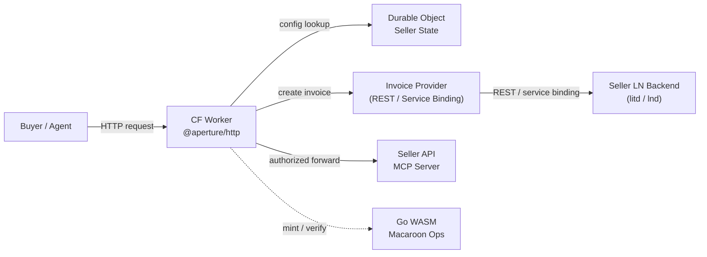
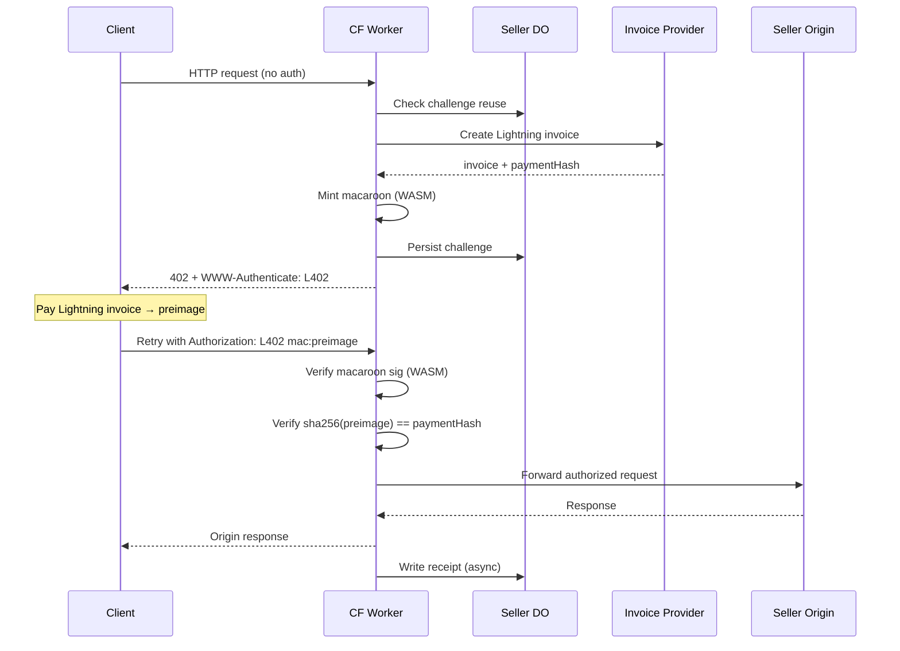
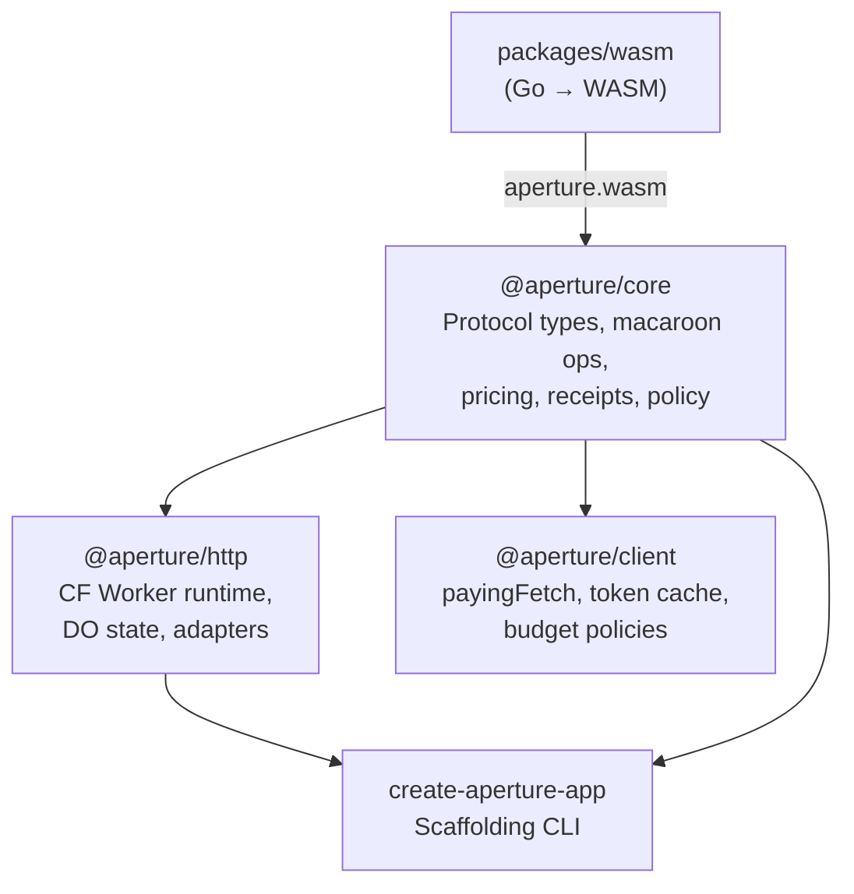

# aperture-ts

TypeScript L402 payment gateway — gate any API or MCP server behind
Lightning Network micropayments using the
[L402 protocol](https://github.com/lightninglabs/L402).

aperture-ts is the TypeScript counterpart to
[aperture](https://github.com/lightninglabs/aperture) (Go). The protocol
core (`@aperture/core`) and buyer SDK (`@aperture/client`) are
framework-agnostic and run anywhere — Node.js, Deno, Bun, or edge
runtimes. The `@aperture/http` package provides first-class Cloudflare
Workers integration (Durable Objects, service bindings) with adapter
hooks for Hono, Express, and Fastify. The security-critical macaroon
layer is shared between both codebases via a Go→WASM bridge, guaranteeing
identical HMAC-SHA256 signing, caveat evaluation, and preimage verification.

## Architecture

### System Overview



### L402 Challenge-Response Flow



### Package Dependency Graph



## Packages

| Package | Description |
|---------|-------------|
| [`@aperture/core`](packages/core/) | L402 protocol types, WASM-backed macaroon operations (mint, verify, caveats), pricing engine, receipt schema, route matching, buyer/seller policy evaluation. Framework-agnostic — no CF Worker or Node dependencies. |
| [`@aperture/http`](packages/http/) | Cloudflare Worker runtime. `createApertureWorkerRuntime()` factory wiring tenant resolution, L402 challenge issuance, credential verification, origin proxying, Durable Object state coordination, and async receipt emission. |
| [`@aperture/client`](packages/client/) | Buyer-side SDK. `payingFetch()` automatically detects 402 challenges, enforces budget/allowlist policies, pays Lightning invoices, caches L402 tokens, and retries with valid credentials. |
| [`create-aperture-app`](packages/create-aperture-app/) | Scaffolding CLI. Generates a paid REST API or paid MCP server project pre-configured for Cloudflare Workers with `wrangler.jsonc` and mock invoice provider. |
| [`wasm`](packages/wasm/) | Go→WASM bridge compiling aperture's macaroon primitives (HMAC-SHA256 signing, caveat verification, identifier encoding) to a 3 MB WebAssembly binary (~890 KB gzip). Vendors `aperture/l402` v0.5.0 caveat/satisfier logic with only 2 Go dependencies. |

## Quick Start

### Seller: Create a Paid API

```bash
npx create-aperture-app my-paid-api --template=rest-worker
cd my-paid-api
pnpm install
pnpm dev
```

This scaffolds a Worker with one paid route (`/v1/search`, 10 sats) and one
free route (`/health`) using a mock invoice provider for local development.

### Seller: Manual Setup

```typescript
import { createApertureWorkerRuntime, StaticTenantResolver, MockInvoiceProvider,
         LocalWorkerHandlerAdapter, NoopReceiptWriter, createWorkerExport } from "@aperture/http";
import { MacaroonIssuer, MacaroonVerifier, initWasm } from "@aperture/core/macaroon";

const runtime = createApertureWorkerRuntime({
  tenantResolver: new StaticTenantResolver(sellerConfig),
  stateStore,
  invoiceProviderFactory: { create: () => new MockInvoiceProvider() },
  macaroonIssuer: new MacaroonIssuer(env.MACAROON_MASTER_KEY),
  macaroonVerifier: new MacaroonVerifier(env.MACAROON_MASTER_KEY),
  receiptWriter: new NoopReceiptWriter(),
  originAdapterFactory: { create: () => new LocalWorkerHandlerAdapter(handler) },
});

export default createWorkerExport(runtime);
```

### Buyer: Auto-Pay with payingFetch

```typescript
import { createPayingFetch } from "@aperture/client";
import { BudgetCapPolicy, HostAllowlistPolicy, CompositeBuyerPolicy } from "@aperture/core/policy";

const payingFetch = createPayingFetch({
  payer: myLightningPayer,
  buyerPolicy: new CompositeBuyerPolicy([
    new BudgetCapPolicy(100),                        // Max 100 sat per request.
    new HostAllowlistPolicy(["api.example.com"]),    // Only pay trusted hosts.
  ]),
});

const response = await payingFetch("https://api.example.com/v1/search", {
  method: "POST",
  headers: { "Content-Type": "application/json" },
  body: JSON.stringify({ query: "hello" }),
});
// If 402 → auto-pays → retries → returns authorized response.
```

## How It Works

### L402 Protocol

L402 combines HTTP 402 Payment Required with Lightning Network invoices and
[macaroons](https://research.google/pubs/pub41892/) (HMAC-chain bearer
credentials):

1. **Challenge**: Server returns 402 with a `WWW-Authenticate: L402 macaroon="...", invoice="..."`
   header. The macaroon's identifier commits to the invoice's payment hash.
2. **Payment**: Client pays the Lightning invoice and receives a preimage
   (32-byte proof of payment).
3. **Authorization**: Client sends `Authorization: L402 <macaroon>:<preimage>`.
   Server verifies the macaroon signature and that `sha256(preimage) == paymentHash`.
4. **Stateless verification**: After the initial challenge, verification requires
   only the root key and the credential — no database lookup needed.

### Macaroon Caveats

Macaroons support attenuation through caveats. Each caveat narrows the scope
of what the credential authorizes:

| Caveat | Example | Purpose |
|--------|---------|---------|
| `services` | `search_api:0` | Which service + tier |
| `seller_id` | `seller_123` | Bound to seller |
| `route_id` | `search_api` | Bound to route |
| `payment_hash` | `abc123...` | Bound to payment |
| `{service}_valid_until` | `1711929600` | Expiry (Unix timestamp) |
| `host` | `api.example.com` | Host binding |
| `path_prefix` | `/v1/search` | Path binding |
| `method` | `GET\|POST` | Method binding |

Caveats can only restrict — never expand — a credential's authority. Clients
can add caveats to delegate narrower access to sub-agents.

### Seller Config Model

Each seller defines routes with pricing and macaroon policies:

```typescript
const sellerConfig: SellerRuntimeConfig = {
  sellerId: "seller_123",
  hostnames: ["api.example.com"],
  defaultCurrency: "SAT",
  auth: { scheme: "L402" },
  invoiceBackend: { kind: "rest", endpoint: "https://litd.internal/v1/invoices" },
  origin: { kind: "proxy", baseUrl: "https://internal.origin" },
  receipts: { mode: "async" },
  routes: [
    {
      routeId: "search_api",
      match: { pathPrefix: "/v1/search", method: ["POST"] },
      challengeMode: "http-402",
      pricing: { kind: "fixed", amountSat: 10 },
      macaroonPolicy: {
        ttlSeconds: 900,
        bindHost: true,
        bindPathPrefix: true,
        bindMethod: true,
        bindRouteId: true,
      },
      backend: { kind: "proxy", target: "/v1/search" },
    },
  ],
};
```

### Pricing Policies

| Type | Behavior |
|------|----------|
| `fixed` | Constant price per request |
| `per-request` | Same as fixed (semantic distinction for analytics) |
| `tiered` | Match request against tier rules, first match wins |
| `free-until` | Free for N requests, then charges |
| `dynamic` | Calls external pricing endpoint |

### Invoice Providers

The Worker doesn't talk directly to LND. Instead, a pluggable invoice
provider abstracts the Lightning backend:

| Adapter | Use Case |
|---------|----------|
| `MockInvoiceProvider` | Local dev and testing |
| `RestInvoiceProvider` | External REST endpoint (litd, seller connector) |
| `ServiceBindingInvoiceProvider` | Internal CF Worker via service binding |

## WASM Bridge

The macaroon layer is the most security-critical piece of the system. To
ensure correctness, it is compiled from Go to WebAssembly rather than
reimplemented in TypeScript.

### What's Compiled

The bridge exposes 7 functions to JavaScript via `globalThis.apertureWasm`:

| Function | Purpose |
|----------|---------|
| `mintMacaroon` | Create macaroon with root key, payment hash, caveats |
| `verifyMacaroon` | Verify HMAC-chain signature, return decoded caveats |
| `verifyPreimage` | Check `sha256(preimage) == paymentHash` |
| `encodeIdentifier` | Encode version-0 L402 identifier (2 + 32 + 32 bytes) |
| `decodeIdentifier` | Decode identifier to version, paymentHash, tokenID |
| `verifyCaveats` | Verify caveats against services + timeout satisfiers |
| `addFirstPartyCaveats` | Add caveats to an existing macaroon |

### Vendored l402

The WASM bridge vendors `caveat.go`, `satisfier.go`, and `service.go` from
[aperture v0.5.0](https://github.com/lightninglabs/aperture/tree/v0.5.0/l402)
into `internal/l402/`. This is necessary because the full `aperture/l402`
package transitively imports `lnd/lnrpc` (gRPC + protobuf) which doesn't
compile to WASM. The vendored files are pure Go with zero lnd imports.

**Dependencies**: `gopkg.in/macaroon.v2` + `golang.org/x/crypto` (just 2).

### Key Derivation

Per-seller macaroon signing keys are derived from a single master secret:

```
sellerKey = HKDF-SHA256(MACAROON_MASTER_KEY, info="seller:{sellerId}:v1")
```

This eliminates per-seller root key storage in the hot path while enabling
easy rotation by changing the derivation version.

## Development

### Prerequisites

- Node.js 20+
- pnpm 9+
- Go 1.22+ (for WASM compilation)

### Setup

```bash
git clone https://github.com/lightninglabs/aperture-ts
cd aperture-ts

# Install JS dependencies.
pnpm install

# Build WASM bridge (required before running tests).
make -C packages/wasm build
```

### Test

```bash
# Run all tests (85 tests across 16 files).
pnpm -r test

# Run per-package.
pnpm --filter @aperture/core test    # 58 tests
pnpm --filter @aperture/http test    # 14 tests
pnpm --filter @aperture/client test  # 13 tests
```

### Project Structure

```
aperture-ts/
├── packages/
│   ├── wasm/                  # Go WASM bridge
│   │   ├── bridge.go          # syscall/js exports
│   │   ├── internal/l402/     # Vendored caveat/satisfier/service
│   │   ├── Makefile           # GOOS=js GOARCH=wasm build
│   │   └── testdata/          # Cross-compat test vectors
│   ├── core/                  # @aperture/core
│   │   └── src/
│   │       ├── auth/          # L402 header parsing, challenge builder
│   │       ├── macaroon/      # WASM loader, issuer, verifier, caveats
│   │       ├── pricing/       # Pricing engine
│   │       ├── receipts/      # Receipt schema + digest
│   │       ├── policy/        # Route matching, buyer/seller policies
│   │       └── util/          # Hashing, idempotency, clock
│   ├── http/                  # @aperture/http
│   │   └── src/
│   │       ├── worker/        # Runtime factory, request lifecycle, errors
│   │       ├── cloudflare/    # Env bindings, Durable Object, DO client
│   │       ├── invoices/      # Mock, REST, service-binding adapters
│   │       ├── proxy/         # Origin forwarding, local handler
│   │       └── adapters/      # CF Worker export wrapper
│   ├── client/                # @aperture/client
│   │   └── src/
│   │       ├── fetch/         # payingFetch, retry logic
│   │       ├── challenge/     # 402 response parser
│   │       ├── policy/        # Budget, allowlist, approval policies
│   │       ├── cache/         # Token cache, receipt cache
│   │       └── payer/         # InvoicePayer interface
│   └── create-aperture-app/   # Scaffolding CLI + templates
├── examples/
│   ├── worker-rest-paid-api/  # Paid REST API example
│   ├── worker-mcp-paid-tool/  # Paid MCP server example
│   └── buyer-client.ts        # Buyer SDK usage example
├── pnpm-workspace.yaml
├── tsconfig.base.json
└── package.json
```

## License

See LICENSE file.
