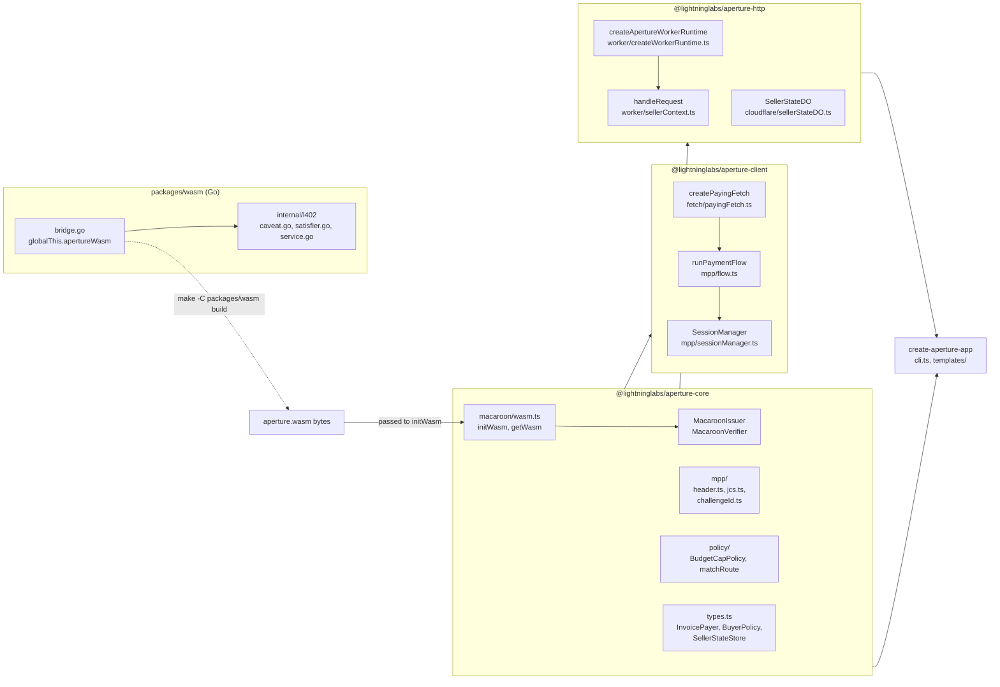
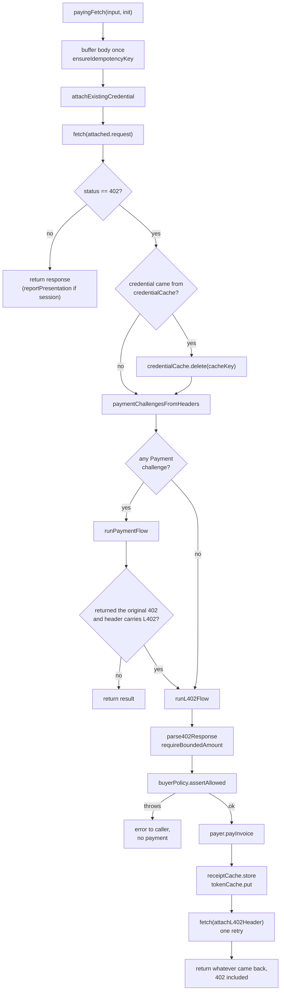
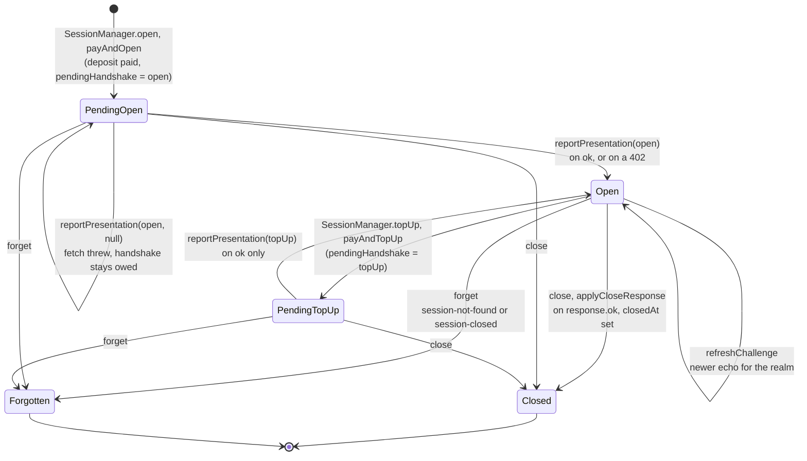
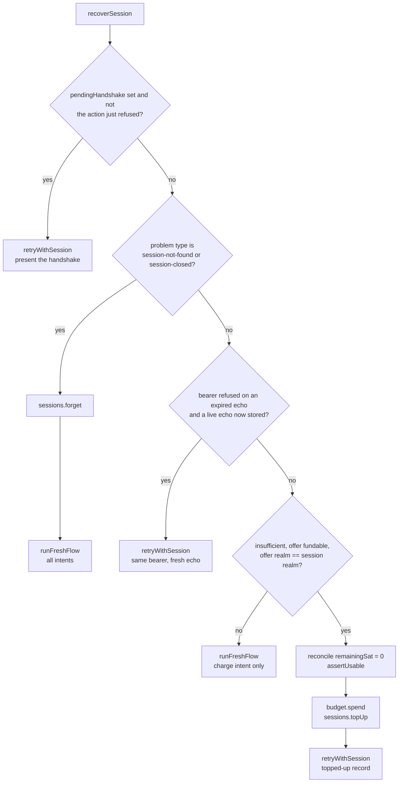
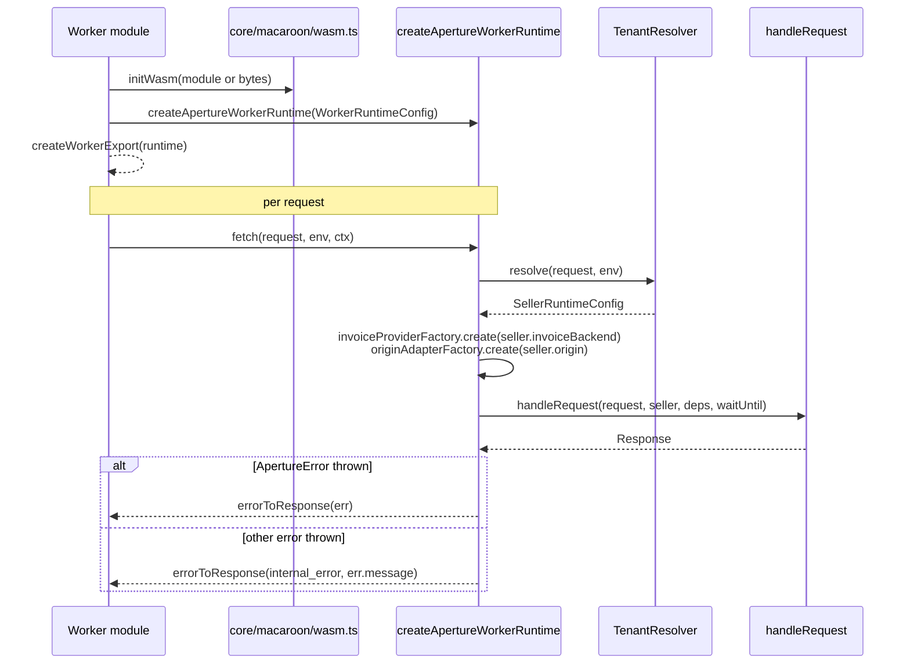
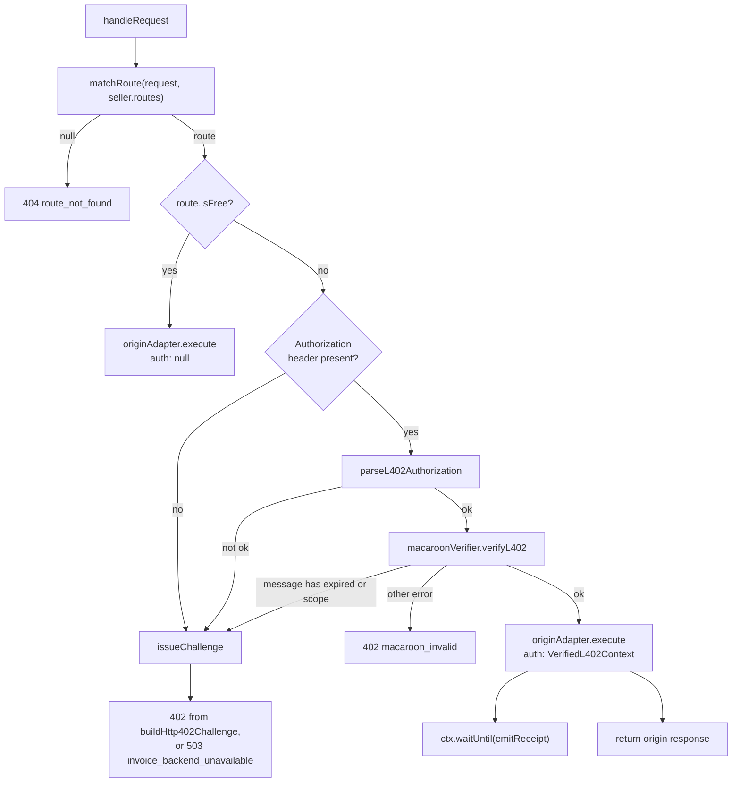
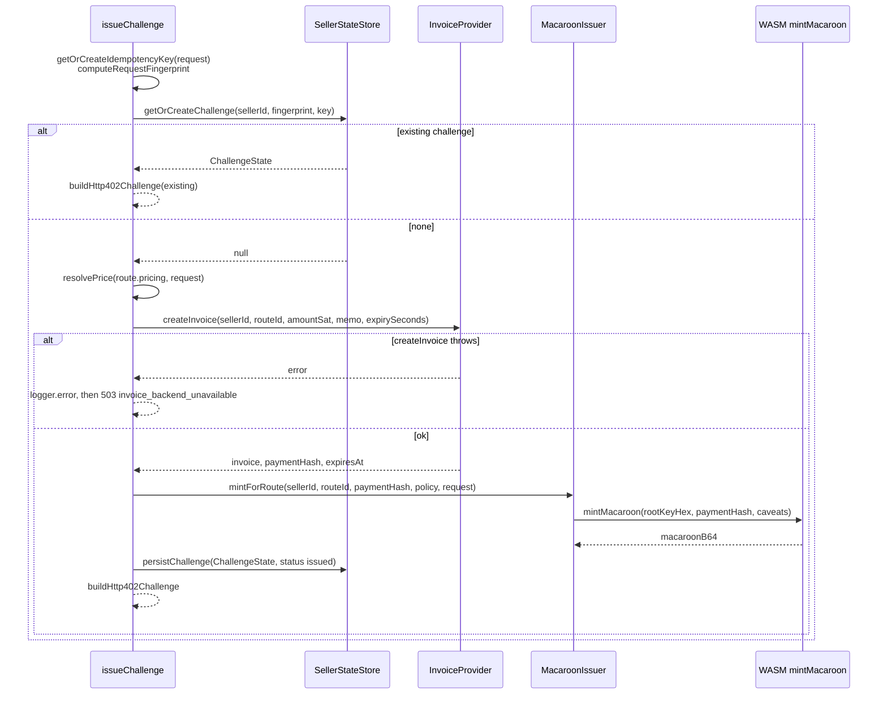

# aperture-ts architecture

aperture-ts is a TypeScript monorepo for paid HTTP over the L402 protocol and the Machine Payments Protocol (MPP). It has a buyer half, which pays a 402 challenge and retries the request, and a seller half, which issues challenges and verifies the credentials that come back. This document maps which package owns which state, how a request moves through the buyer loop and the seller worker, and where the repository stops. It describes the tree at `1ab2c1d` (`main` after #10). For usage and configuration, see the [README](../README.md); for per-package contracts, see the `CLAUDE.md` in each `packages/*` directory.

## Package graph

The repository is a pnpm workspace of five packages plus `examples/`. Dependencies run in one direction: `@lightninglabs/aperture-core` depends on nothing in the workspace, and every other TypeScript package depends on it. The buyer and seller packages never import each other.

Three points follow from the graph.

- **The WASM binary is an input, not a dependency.** `packages/wasm` builds `dist/aperture.wasm` with `GOOS=js GOARCH=wasm`. `@lightninglabs/aperture-core` does not import it; the caller hands the compiled module or its bytes to `initWasm`, and `getWasm` throws until that has happened. `initWasmFromDisk` in `@lightninglabs/aperture-core/node` is the only entry point that reads the file system.
- **The buyer path needs no WASM.** `@lightninglabs/aperture-client` never calls `getWasm`. A buyer holds a macaroon as an opaque string and does not sign or verify it.
- **The MPP wire layer lives in core.** `@lightninglabs/aperture-core/mpp` holds the header codecs, JCS canonicalization, and the challenge-id HMAC, because both a buyer and a seller need them. Only the buyer consumes them in this tree.

### Responsibilities

| Package | Owns | Does not own |
| --- | --- | --- |
| `packages/wasm` | Macaroon mint, signature verification, caveat satisfiers (`services`, `<service>_valid_until`), and the 66-byte version-0 identifier codec, as seven functions on `globalThis.apertureWasm`. | Key derivation, route policy, any HTTP concept. |
| `@lightninglabs/aperture-core` | Shared types (`types.ts`), `MacaroonIssuer`, `MacaroonVerifier`, `deriveSellerKey`, `matchRoute`, `resolvePrice`, `BuyerPolicy` implementations, receipt schema, and the MPP wire layer. | Any network call (except `resolveDynamicPrice`), any persistent state, any wallet. |
| `@lightninglabs/aperture-client` | `payingFetch`, the 402 dispatcher, the L402 and MPP paths, `SessionManager`, and the four stores (`TokenStore`, `CredentialStore`, `SessionStore`, `ReceiptStore`) with in-memory defaults. | Paying an invoice (the injected `InvoicePayer` does), minting a return invoice (the injected `ReturnInvoiceMinter` does), durable storage. |
| `@lightninglabs/aperture-http` | The Worker fetch handler, request lifecycle, error-to-status mapping, invoice providers, origin adapters, and the `SellerStateDO` Durable Object. | Wallet, Lightning node, the choice of `SellerStateStore` implementation. |
| `create-aperture-app` | A CLI that copies `templates/rest-worker` or `templates/mcp-worker` into a new directory. | Anything at runtime. |

## What the repository does not own

Four things sit outside this tree, and the code assumes each of them.

| Outside component | Where the code meets it |
| --- | --- |
| The Go [aperture](https://github.com/lightninglabs/aperture) proxy | `packages/wasm/internal/l402` is a vendored subset of its `l402` package. `packages/core/testdata/mpp` holds a two-way interop harness against its `mpp` package: `vectors.json` is generated by Go and asserted by TypeScript tests, and a Go seller verifies a transcript the TypeScript buyer emits. Nothing in this repository runs the Go proxy. |
| Lightning wallets | The buyer sees only `InvoicePayer.payInvoice` (returns `preimageHex` and `amountPaidSat`) and `ReturnInvoiceMinter.mintAmountlessInvoice`. `MockInvoicePayer` is the only implementation in the tree. |
| The seller's Lightning node | The seller sees only `InvoiceProvider.createInvoice`. `RestInvoiceProvider` posts to an endpoint, `ServiceBindingInvoiceProvider` calls a Worker through a service binding, and `MockInvoiceProvider` fabricates invoices. No code here watches for settlement. |
| The seller's origin | `OriginAdapter.execute`, implemented by `ProxyOriginAdapter` (an outbound `fetch`) and `LocalWorkerHandlerAdapter` (a function call). |

## The buyer loop

`createPayingFetch` returns a function with the `fetch` signature. One call to it makes at most one payment and at most one paid retry, on every path through both protocols. The sections below follow a request from the first attempt to the caller's response.

1. **Buffer.** `payingFetch` reads the request body into an `ArrayBuffer` once, then rebuilds every `Request` from those bytes through `attachAuthorization` or `attachL402Header`. The rebuilt request carries the caller's `AbortSignal`, so aborting cancels the fetch. `ensureIdempotencyKey` sets an `Idempotency-Key` header (a random UUID) on any method other than `GET` and `HEAD` that lacks one, so the first attempt and the paid retry send the same key.
2. **Attach.** `attachExistingCredential` presents at most one credential, in the order most specific first: an entry in the `CredentialStore` for this origin, route, and method; then a `TokenStore` entry under the same key; then the most recently used open session on the origin (`SessionManager.findForOrigin`). The key is `origin|routeId|method`, where `routeId` is `init.routeId` or the URL path.
3. **First fetch.** If the request carried a session credential, `SessionManager.reportPresentation` receives the response, or `null` when the fetch threw.
4. **Clear.** A non-402 response is returned unchanged. A 402 after a cached payment credential deletes that `CredentialStore` entry, since the server has refused it.
5. **Dispatch.** `paymentChallengesFromHeaders` reads only headers, because a 402 body can be consumed once. If it finds a usable `Payment` challenge, `runPaymentFlow` runs. If the flow returns the original response object and the `WWW-Authenticate` header also carries an L402 challenge (`carriesL402Challenge`), control falls through to the L402 path. Otherwise the result is returned.
6. **L402 path.** `runL402Flow` is described in the next section.

### L402 payment

`runL402Flow` handles one challenge. Its order is fixed so that no wallet action precedes a policy check and no failure after payment loses the credential.

1. **Parse.** `parse402Response` reads the JSON body (`challenge_id`, `route_id`, `amount_sat`, `invoice`, `macaroon`, `expires_at`) when the content type is JSON, and the `WWW-Authenticate` and `X-Aperture-*` headers otherwise.
2. **Bound.** `resolveAmountSat` takes the larger of the stated price and the amount decoded from the BOLT11 invoice. `requireBoundedAmount` throws if the invoice amount cannot be decoded or is zero, so the budget policy is never asked about an outflow the seller could set after the fact.
3. **Authorize.** `BuyerPolicy.assertAllowed` receives `url`, `host`, `amountSat`, and `routeId`. A throw ends the call with no payment.
4. **Pay.** After a second abort check, `InvoicePayer.payInvoice` returns the preimage.
5. **Record.** `paymentHashFromPreimage` derives `sha256(preimage)`. A `Promise.allSettled` writes the `ClientReceipt` and the `CachedToken`. A rejected write is logged and does not abort the call, because the credential is already in hand.
6. **Retry.** `attachL402Header` builds `Authorization: L402 <macaroon>:<preimage>` and the loop calls `fetch` once. The caller gets that response.

### Policies

`BuyerPolicy` is a one-method interface in core. `BudgetCapPolicy` rejects an amount above a per-request cap, `WindowBudgetPolicy` tracks spend within a time window, `HostAllowlistPolicy` and `RouteAllowlistPolicy` check sets, and `CompositeBuyerPolicy` requires all of its members to pass. `ManualApprovalPolicy` in the client package calls a user-supplied async function. `WindowBudgetPolicy` adds the amount to its counter at assertion time, so a payment that later fails still counts against the window.

## The credential and token stores

The client keeps four kinds of state, each behind an interface whose methods may be synchronous or asynchronous (the loop awaits all of them). Each default implementation is process-local, so a restart discards its contents.

| Store | Key | Holds | Default | Eviction |
| --- | --- | --- | --- | --- |
| `TokenStore` | `origin\|routeId\|method` | `CachedToken`: macaroon, preimage, `expiresAt`. A paid L402 bundle. | `TokenCache` | On read, if `expiresAt` has passed or does not parse. |
| `CredentialStore` | `origin\|routeId\|method` | `CachedCredential`: the full `Authorization` value for a paid charge, the challenge id, optional `expiresAt`. | `CredentialCache` | On read, same rule; and `payingFetch` deletes an entry the server refused. |
| `SessionStore` | `origin\|realm` | `SessionRecord`: deposit, spend estimate, challenge echo, return invoice, deposit preimage, pending handshake. | `SessionCache` | None. `SessionManager` marks `closedAt` or deletes through `forget`. |
| `ReceiptStore` | payment hash | `ClientReceipt` for the audit trail. | `ReceiptCache` | None. |

Two rules govern these stores.

- **Keys use the full origin.** The key begins with `url.origin` (scheme, host, and port), not the hostname, so two proxies on different ports of one host, or a plaintext and a TLS origin, never share a credential.
- **Stored values are bearer secrets.** A `CachedToken` and a `CachedCredential` spend the balance they were bought with. A `SessionRecord` holds `depositPreimage`, which the close credential presents as proof that the caller funded the session. The interfaces' comments tell durable implementations to protect these values like keys. No durable implementation ships in this repository.

The credential cache exists for one failure. If the paid retry throws after the invoice settled, the caller will retry the whole request. With the credential stored before the retry, that second attempt presents it and does not buy again.

## MPP: charge and session

When a 402 carries `WWW-Authenticate: Payment` challenges, `runPaymentFlow` takes over. It constructs a `PaymentBudget`, a counter whose `spend()` throws on the second call. The guard is a tripwire against a future bug, since every path is written to reach at most one payment.

### Offers

`toTypedChallenge` keeps only challenges whose method is `lightning` and whose request object decodes. A `charge` offer must carry `methodDetails.invoice`; a `session` offer must carry `paymentHash`. Anything else is dropped without an error, so one unusable offer does not cost the client a usable neighbor. `selectChallenge` picks by intent preference, which defaults to `["session", "charge"]` and is set by `MppConfig.intents`. A session offer is usable only if `SessionManager.canOpenSessions()` is true (a `ReturnInvoiceMinter` is configured, or `allowSessionWithoutRefund` is set) and the offer has a `depositInvoice`.

The credential echoes the challenge parameters byte for byte (`toChallengeEcho`). The server recomputes an HMAC over seven pipe-joined slots (realm, method, intent, request, expires, digest, opaque, built by `buildChallengeHmacInput`), so a rewritten field produces a credential the server refuses. `description` is outside the binding.

### Charge

`payChargeAndRetry` bounds the amount with `resolveAmountSat` and `requireBoundedAmount`, asserts the buyer policy, and pays. It builds the credential with `buildChargeCredential`, writes the `ClientReceipt` and the `CachedCredential` with `Promise.allSettled`, and retries once. `noteReceipt` then reads `Payment-Receipt` and reports a mismatch through `onReceiptMismatch` and `console.warn`. A mismatch never fails the call.

### Session state

A session turns one deposit into a bearer balance. The state lives in `SessionRecord`; `SessionManager` is the only writer. The server learns of a deposit only when it sees the `open` or `topUp` credential, so the record holds a `pendingHandshake` until a response acknowledges it.

The diagram omits three rules.

- **Identity is derived.** `sessionId` is the payment hash computed from the preimage the wallet returned (`settledPaymentHash`, then `requireVerifiedHash` against the challenge's `paymentHash`). A challenge that names a different hash describes a different invoice, and no session is built on it.
- **Deposits coalesce.** `open` and `topUp` both run inside `coalesceDeposit`, which keeps one in-flight promise per session key in `inFlightDeposit`. Concurrent callers await it and share one payment. `credentialForRequest` serializes handshake presentation the same way through `inFlightHandshake`, since the server refuses a replayed `open`.
- **The balance is an estimate.** `remainingSat` is `depositedSat - spentEstimateSat`. `needsTopUp` compares it with `pricePerUnitSat * minUnitsRemaining` (default 1) and returns false when no unit price was quoted. `reconcile` overwrites the estimate with a server figure rather than averaging.

### Session policy and refunds

The budget policy is asserted on the deposit at `open` and `topUp` (`authorizeDeposit`) and not on bearer requests, which move no money at the wallet. `payAndOpen` mints the amountless return invoice through the `ReturnInvoiceMinter` before it pays, so a failure to mint leaves the wallet untouched. `close` waits for in-flight deposits, looping at most `MAX_DEPOSIT_DRAINS` (8) times, sends a `close` credential to `openUrl`, and marks `closedAt` only if the response is `ok`. `closeAll` closes every open session and logs, without stopping, on a failure. `PayingFetch.closeSessions` exposes it, and it must be called by the application before exit, since nothing else closes sessions.

### Recovery from a refused bearer

When a request carried a session credential and the server answers 402, `runPaymentFlow` calls `recoverSession`. Its branches are ordered because the wrong recovery loses money: topping up a session the server discarded burns the top-up, and opening a new session while the old one is merely empty strands the first deposit.

"Insufficient" means the problem type is `insufficient-balance` or `payment-insufficient`, or there is no problem document and the local estimate is zero. `runFreshFlow` after a `forget` can open a replacement session, and after any other fall-through it is restricted to the `charge` intent. The retry in each handled branch is the single paid retry; whatever it returns is the caller's response.

## The seller worker

`@lightninglabs/aperture-http` implements the seller for L402 only. The package contains no `Payment` scheme code, so a deployment built from it issues and verifies L402 challenges and never emits a `Payment` challenge.

### Construction

`createApertureWorkerRuntime(config)` returns `{ fetch(request, env, ctx) }`. On each request it resolves the tenant, asks the factories for an `InvoiceProvider` and an `OriginAdapter` for that seller, bundles them with the shared issuer, verifier, receipt writer, state store, and logger into `RequestHandlerDeps`, and calls `handleRequest`. `createWorkerExport` wraps the result as an `ExportedHandler`.

`initWasm` must run before the first request that mints or verifies, because `getWasm` throws otherwise. `MACAROON_MASTER_KEY` reaches the runtime through the `MacaroonIssuer` and `MacaroonVerifier` constructors, not through `Env`.

### Request lifecycle

`handleRequest` runs the steps in a fixed order. Each branch ends in a response or in a call to the next step.

1. **Match.** `matchRoute` returns the first route whose host (exact or `*.` wildcard), `pathPrefix`, `method` list, and `contentTypePrefix` list all match. No match is a 404.
2. **Free routes.** A route with `isFree` skips authentication and calls the origin with `auth: null`.
3. **Parse.** `parseL402Authorization` accepts the `L402` and `LSAT` schemes, rejects a header longer than `MAX_AUTH_HEADER_SIZE` (4096), requires a 64-character hex preimage, and splits macaroon from preimage on the last colon. A parse failure is answered with a fresh challenge, not a 400.
4. **Verify.** `MacaroonVerifier.verifyL402` is described below. The handler decides between a new challenge and a hard error by testing whether the error message contains `expired` or `scope`, and does not read `VerificationError.reason`.
5. **Forward.** `ProxyOriginAdapter` rewrites scheme, host, and port to the origin's `baseUrl`, prefixes the route's `backend.target` to the path, deletes any `WWW-Authenticate` header from the request, and sets `X-Aperture-Seller-Id`, `X-Aperture-Route-Id`, `X-Aperture-Payment-Hash`, and (if present) `X-Aperture-Tier`. `LocalWorkerHandlerAdapter` calls a function with the same context.
6. **Receipt.** `emitReceipt` is passed to `ctx.waitUntil`, so it runs after the response is returned. It builds an `ApertureReceiptV1` and calls `ReceiptWriter.writeReceipt`.

### Challenge issuance

`issueChallenge` creates the invoice, the macaroon, and the stored challenge state, or returns an earlier challenge for the same request.

- **Reuse key.** The fingerprint is `sha256(sellerId|routeId|method|path|contentType|idempotencyKey)`. `getOrCreateIdempotencyKey` returns the `Idempotency-Key` header if present, a random 16-byte hex value for other methods than `GET` and `HEAD`, and `undefined` for those two. A client that sends no key therefore never matches an earlier non-`GET` challenge. `payingFetch` always sets one, which is what lets a seller reuse a challenge across the buyer's first attempt and retry.
- **Challenge id.** `ch_` followed by the first 8 characters of a random UUID.
- **Backend failure.** Only the `createInvoice` call is wrapped. The caller sees a fixed message and a 503, and the provider's own error text goes to `deps.logger?.error`. The runtime passes `config.logger` into `RequestHandlerDeps`; with no logger configured the detail is dropped. A failure anywhere else in `issueChallenge` (pricing, minting, persistence) propagates to the runtime's catch and is returned as `internal_error` with the error's message.
- **Response shape.** `buildHttp402Challenge` returns a JSON body and the headers `WWW-Authenticate: L402 macaroon="...", invoice="..."`, `X-Aperture-Challenge-Id`, `X-Aperture-Price-Sat`, and `X-Aperture-Route-Id`. The buyer's `parse402Response` reads these.

### Verification

`MacaroonVerifier.verifyL402` runs five steps against the WASM bridge.

1. **Derive.** `deriveSellerKey` computes HKDF-SHA256 over the master key with a 32-byte zero salt and `info` of `seller:<sellerId>:v1`, producing 32 bytes.
2. **Signature.** `wasm.verifyMacaroon(rootKeyHex, macaroonB64)` checks the HMAC chain and returns the caveats.
3. **Payment hash.** The `payment_hash` caveat must be present.
4. **Preimage.** `wasm.verifyPreimage` checks `sha256(preimage)` against that hash.
5. **Caveats.** `wasm.verifyCaveats(macaroonB64, rootKeyHex, route.routeId, nowUnix)` evaluates the `services` and `<service>_valid_until` satisfiers.

No database read occurs. The `host`, `path_prefix`, and `method` caveats are minted when the route's `macaroonPolicy` sets `bindHost`, `bindPathPrefix`, or `bindMethod`, but the verifier does not pass the request to the bridge and no satisfier for them exists in the bridge. See Known gaps.

### Seller state

`SellerStateStore` is an interface in core with three methods: `getOrCreateChallenge`, `persistChallenge`, and `writeReceipt`. The caller of `createApertureWorkerRuntime` supplies the implementation. The templates and examples use a `Map` in the Worker's memory, which is isolate-local and lost on eviction.

`SellerStateDO` is a Durable Object with three routes (`/challenge/get`, `/challenge/persist`, `/receipt/write`) that store `challenge:<fingerprint>` and `receipt:<receiptId>` keys. It deletes an expired challenge on read. `SellerStateClient` addresses it by the name `seller:<sellerId>` and exposes `getChallenge`, `persistChallenge`, and `writeReceipt`. Neither the runtime nor `handleRequest` calls them; `handleRequest` calls `ReceiptWriter.writeReceipt` and never `SellerStateStore.writeReceipt`.

### Error mapping

`errorToResponse` maps `ApertureErrorCode` to a status: `route_not_found` 404, `payment_required` 402, `invalid_authorization_header` 400, `macaroon_invalid`, `preimage_invalid`, `credential_expired`, and `insufficient_scope` 402, `invoice_backend_unavailable` 503, `origin_unavailable` 502, `policy_denied` 403, and `internal_error` 500. The body is `{ "error": code, "message": message }`. In the handler, only `route_not_found`, `macaroon_invalid`, `invoice_backend_unavailable`, and `internal_error` are raised; the others are reserved in the type.

## Concurrency

Both halves run on a JavaScript event loop, so no lock protects any of the state below. Interleaving happens only at `await` points.

| Owner | State | Rule |
| --- | --- | --- |
| One `payingFetch` call | Buffered body, rebuilt `Request`s, `PaymentBudget` | Local to the call. |
| `SessionManager` | `inFlightDeposit`, `inFlightClose`, `inFlightHandshake`, `handshakeRelease` | Keyed by session key; a second caller awaits the existing promise. |
| `SessionManager` | `SessionRecord` in the `SessionStore` | Read-modify-write through `store.put` without a lock, so a store shared between processes can lose an update. |
| `TokenCache`, `CredentialCache`, `ReceiptCache`, `SessionCache` | A `Map` each | Single process. |
| `createApertureWorkerRuntime` | Nothing per runtime | Resolves a tenant and builds `deps` per request. |
| `SellerStateDO` | Durable Object storage | Cloudflare serializes requests to one object. The runtime does not currently reach it. |
| Worker isolate | `globalThis.apertureWasm` | One bridge per isolate. |

Three consequences matter to a caller.

- **Only session deposits coalesce.** Two simultaneous requests with no cached L402 token each reach `runL402Flow` and each pay.
- **A thrown error after payment does not mean no payment.** The credential and receipt are stored before the retry. A caller that sees an exception from a paid retry can call `payingFetch` again and will present the stored credential.
- **Receipt emission may be dropped.** `waitUntil` lets the runtime finish the write after the response, but a `writeReceipt` that throws inside the promise is not reported to the buyer or retried.

## Known gaps

This document does not verify behavior by running the code, and it skips or qualifies the following.

- **Host, path, and method caveats are not enforced.** `MacaroonVerifier.verifyL402` takes `_request` and ignores it. The README's caveat table lists these three as bindings; the code mints them and never evaluates them.
- **Dynamic pricing is not wired into the seller.** `resolvePrice` throws for `kind: "dynamic"`, and `issueChallenge` calls `resolvePrice`, not `resolveDynamicPrice`. Such a route returns `internal_error`. `free-until` reads `ctx.usageCount`, which `issueChallenge` does not set.
- **Receipt fields are placeholders.** `emitReceipt` writes `amountSat: 0` and `invoice: ""`; its comment says these are filled from challenge state if needed, and no code does.
- **`SellerStateDO` is not connected to `SellerStateStore`.** No adapter in the tree implements `SellerStateStore` on top of `SellerStateClient`.
- **No seller-side MPP.** Only the wire layer in core and the buyer are present. The `maxUses` policy field and revocation, listed in the Durable Object's header comment, have no implementation.
- **No durable stores.** All four client stores default to memory and no persistent implementation ships here.
- **`packages/wasm` internals are summarized, not audited.** The Go side is described from `bridge.go` and the package `CLAUDE.md`; the vendored `internal/l402` files were not read line by line.
- **`create-aperture-app` and `examples/`** are described by their `CLAUDE.md` and entry files only.
